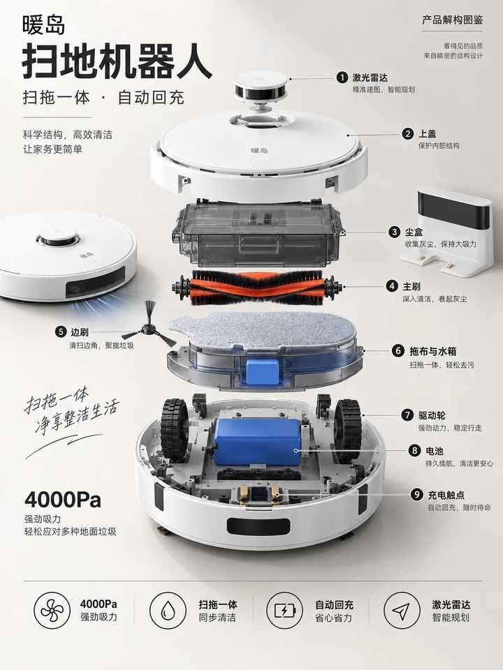
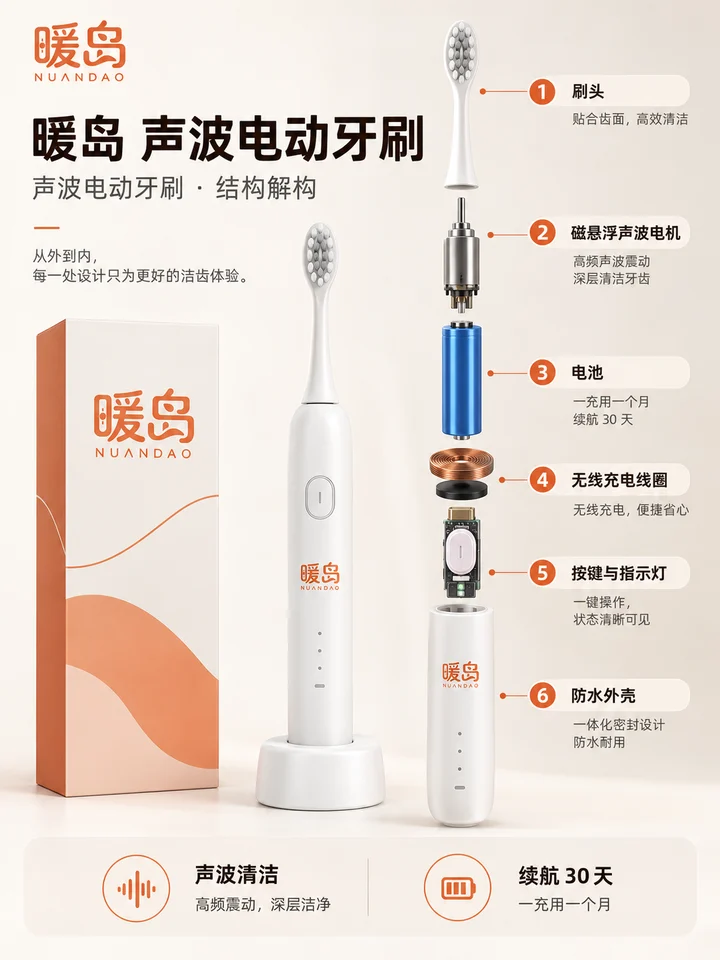
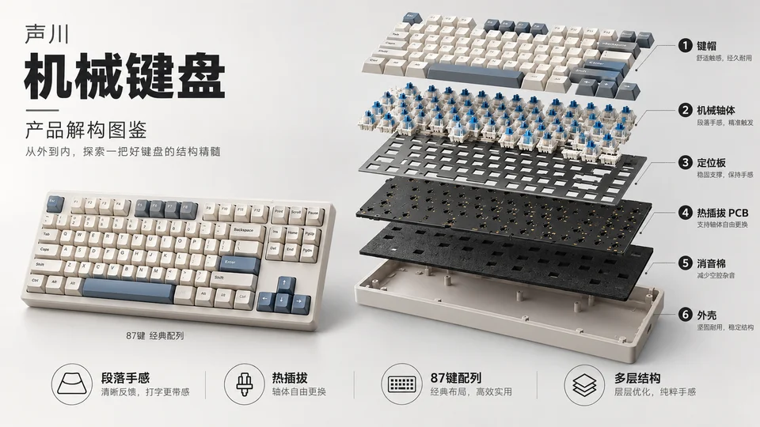
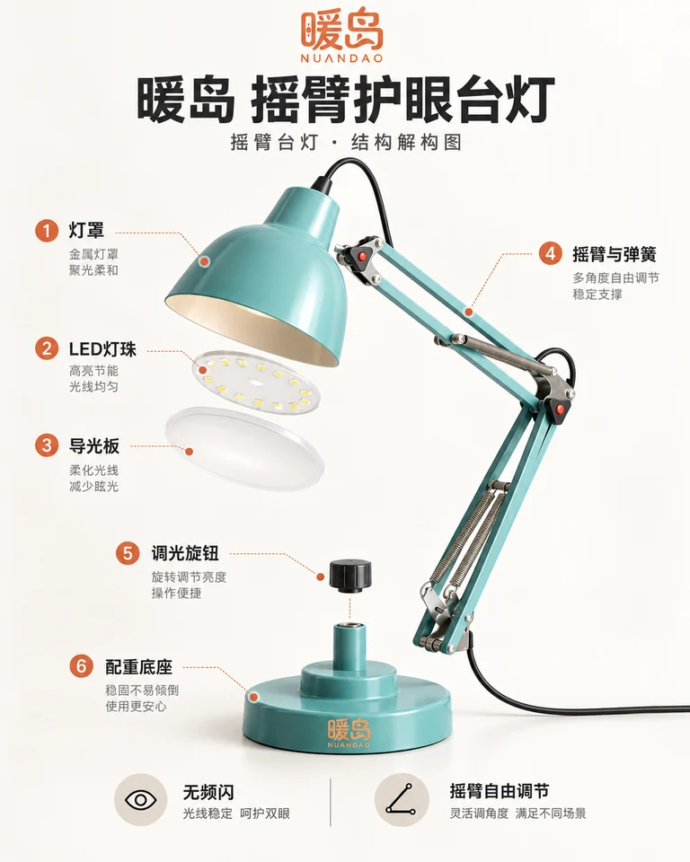
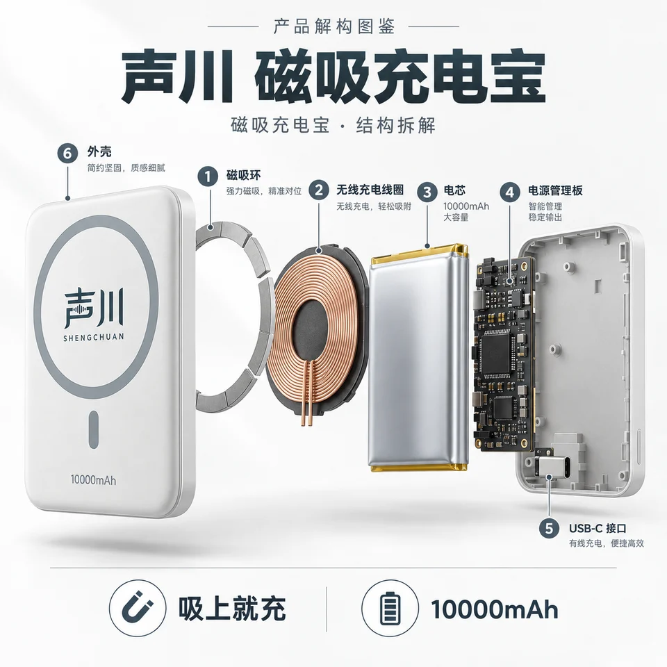
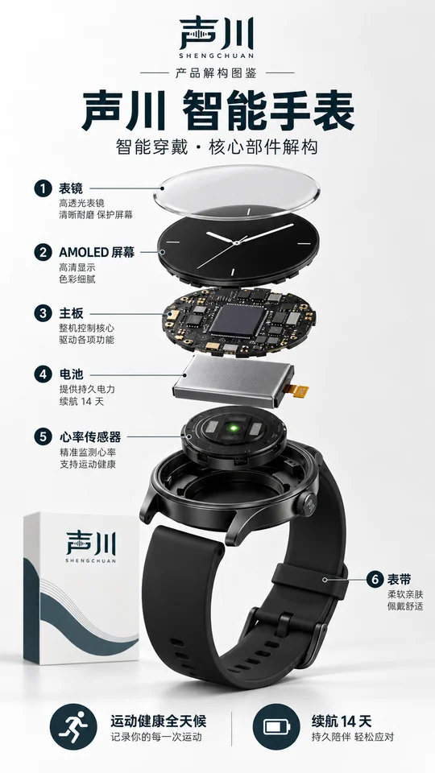

<div align="center">

# 🦁 XXD Shop 007｜产品解构图鉴

### 拆开给你看，每个零件都说得清

<strong>简体中文</strong> · <a href="README.en.md">English</a>

</div>

**把产品按真实装配顺序“拆开”给顾客看，每个零件都说得清是什么、解决什么。**
介于工程图和 AI 乱画之间的那张图：好看，而且不编。

| 一眼看懂 | |
|---|---|
| **交给它** | 产品图（必需）；爆炸图、图纸、说明书或部件名单（越全越准）；功率、续航等参数 |
| **你拿到** | 详情页头图、核心卖点页、技术页用的产品解构海报；也能一次出一组三页 |
| **风格特点** | 干净浅底 · 居中爆炸拆分 · 细线编号短标注 · 少量信息卡 · 底部卖点图标 |
| **最适合** | 数码、家电、个护电器、工具等需要讲清“里面有什么”的商品 |

> **装好后，直接这样说：**
>
> /xxd-shop-007 这是扫地机外观和官方爆炸图，部件有上盖、激光雷达、主控板、电池、风机、边刷、主刷、尘盒，做一张详情页拆解图

<!-- xxd-samples:start -->
## 样张

<p align="center"><a href="assets/examples/p01-set-3x4-1086x1448.png"></a><br><sub>详情页 · 3:4 · 1086x1448<br>暖岛 6L 空气炸锅 · <a href="assets/examples/sources/product-nuandao-fryer.jpg">商品图</a> + <a href="assets/examples/sources/logo-nuandao.png">Logo</a> · 模型写字（中文）<br>第 1 / 3 张</sub></p>

### 能做哪些品类

每格一个品类，点开看大图；下面各段有用途、比例、像素和输入说明。

<table>
<tr><td align="center" valign="top"><a href="assets/examples/c01-category-3x4-1086x1448.png"></a><br><sub><b>家电</b><br>详情页结构说明</sub></td><td align="center" valign="top"><a href="assets/examples/c02-category-3x4-1086x1448.png"></a><br><sub><b>个护清洁</b><br>详情页</sub></td><td align="center" valign="top"><a href="assets/examples/c03-category-16x9-1672x941.png"></a><br><sub><b>3C 数码</b><br>参数页横版</sub></td><td align="center" valign="top"><a href="assets/examples/c04-category-4x5-1122x1402.png"></a><br><sub><b>家居</b><br>详情页</sub></td></tr>
</table>

### 一个商品，适配每个位置

同一商品、同一套风格，每个比例都重新构图，不是裁切。

<table>
<tr><td align="center" valign="top"><a href="assets/examples/s01-size-1x1-1254x1254.png"></a><br><sub>详情页结构说明 · 1:1 · 1254x1254<br>声川 头戴降噪耳机 · <a href="assets/examples/sources/product-sc-headphones.jpg">商品图</a> + <a href="assets/examples/sources/logo-shengchuan.png">Logo</a> · 模型写字（中文）</sub></td><td align="center" valign="top"><a href="assets/examples/s02-size-3x4-1086x1448.png"></a><br><sub>详情页 · 3:4 · 1086x1448<br>声川 头戴降噪耳机 · <a href="assets/examples/sources/product-sc-headphones.jpg">商品图</a> + <a href="assets/examples/sources/logo-shengchuan.png">Logo</a> · 模型写字（中文）</sub></td><td align="center" valign="top"><a href="assets/examples/s03-size-9x16-941x1672.png"></a><br><sub>竖屏 · 9:16 · 941x1672<br>声川 头戴降噪耳机 · <a href="assets/examples/sources/product-sc-headphones.jpg">商品图</a> + <a href="assets/examples/sources/logo-shengchuan.png">Logo</a> · 模型写字（中文）</sub></td><td align="center" valign="top"><a href="assets/examples/s04-size-16x9-1672x941.png"></a><br><sub>参数页横版 · 16:9 · 1672x941<br>声川 头戴降噪耳机 · <a href="assets/examples/sources/product-sc-headphones.jpg">商品图</a> + <a href="assets/examples/sources/logo-shengchuan.png">Logo</a> · 模型写字（中文）</sub></td></tr>
</table>

### 拆解详情组（套图）：头图、卖点页、技术页

<table>
<tr><td align="center" valign="top"><a href="assets/examples/p01-set-3x4-1086x1448.png"></a><br><sub>详情页 · 3:4 · 1086x1448<br>暖岛 6L 空气炸锅 · <a href="assets/examples/sources/product-nuandao-fryer.jpg">商品图</a> + <a href="assets/examples/sources/logo-nuandao.png">Logo</a> · 模型写字（中文）<br>第 1 / 3 张</sub></td><td align="center" valign="top"><a href="assets/examples/p02-set-3x4-1086x1448.png"></a><br><sub>详情页 · 3:4 · 1086x1448<br>暖岛 6L 空气炸锅 · <a href="assets/examples/sources/product-nuandao-fryer.jpg">商品图</a> + <a href="assets/examples/sources/logo-nuandao.png">Logo</a> · 模型写字（中文）<br>第 2 / 3 张</sub></td><td align="center" valign="top"><a href="assets/examples/p03-set-3x4-1086x1448.png"></a><br><sub>详情页 · 3:4 · 1086x1448<br>暖岛 6L 空气炸锅 · <a href="assets/examples/sources/product-nuandao-fryer.jpg">商品图</a> + <a href="assets/examples/sources/logo-nuandao.png">Logo</a> · 模型写字（中文）<br>第 3 / 3 张</sub></td></tr>
</table>

### 换一个品类也成立

<table>
<tr><td align="center" valign="top"><a href="assets/examples/c01-category-3x4-1086x1448.png"></a><br><sub>详情页结构说明 · 3:4 · 1086x1448<br>暖岛 扫地机器人 · <a href="assets/examples/sources/product-nuandao-robot.jpg">商品图</a> + <a href="assets/examples/sources/logo-nuandao.png">Logo</a> · 模型写字（中文）</sub></td><td align="center" valign="top"><a href="assets/examples/c02-category-3x4-1086x1448.png"></a><br><sub>详情页 · 3:4 · 1086x1448<br>暖岛 声波电动牙刷 · <a href="assets/examples/sources/product-nuandao-toothbrush.jpg">商品图</a> + <a href="assets/examples/sources/logo-nuandao.png">Logo</a> · 模型写字（中文）</sub></td><td align="center" valign="top"><a href="assets/examples/c03-category-16x9-1672x941.png"></a><br><sub>参数页横版 · 16:9 · 1672x941<br>声川 机械键盘 · <a href="assets/examples/sources/product-sc-keyboard.jpg">商品图</a> + <a href="assets/examples/sources/logo-shengchuan.png">Logo</a> · 模型写字（中文）</sub></td></tr>
<tr><td align="center" valign="top"><a href="assets/examples/c04-category-4x5-1122x1402.png"></a><br><sub>详情页 · 4:5 · 1122x1402<br>暖岛 摇臂护眼台灯 · <a href="assets/examples/sources/product-nuandao-lamp-desk.jpg">商品图</a> + <a href="assets/examples/sources/logo-nuandao.png">Logo</a> · 模型写字（中文）</sub></td><td align="center" valign="top"><a href="assets/examples/c05-category-1x1-1254x1254.png"></a><br><sub>详情页结构说明 · 1:1 · 1254x1254<br>声川 磁吸充电宝 · <a href="assets/examples/sources/product-sc-powerbank.jpg">商品图</a> + <a href="assets/examples/sources/logo-shengchuan.png">Logo</a> · 模型写字（中文）</sub></td><td align="center" valign="top"><a href="assets/examples/c06-category-9x16-941x1672.png"></a><br><sub>竖屏 · 9:16 · 941x1672<br>声川 智能手表 · <a href="assets/examples/sources/product-sc-watch.jpg">商品图</a> + <a href="assets/examples/sources/logo-shengchuan.png">Logo</a> · 模型写字（中文）</sub></td></tr>
<tr><td align="center" valign="top"><a href="assets/examples/s08-category-3x4-1086x1448.png"></a><br><sub>详情页 · 3:4 · 1086x1448<br>暖岛 高速吹风机 · <a href="assets/examples/sources/product-nuandao-dryer-black.jpg">商品图</a> + <a href="assets/examples/sources/logo-nuandao.png">Logo</a> · 模型写字（中文）</sub></td></tr>
</table>

<sub>样张商品均为虚构的演示品牌，价格、规格等数字为演示设定；演示商品图与 Logo 由本项目生成，部分以 Unsplash 照片为底，署名与许可见 [assets/examples/README.md](assets/examples/README.md)。每张都是单次生成的完整画面，未修图、未拼接、未放大，像素照实标注；没通过目视验收的已重出，不放进来。点开看原尺寸。</sub>

<!-- xxd-samples:end -->

## 它解决什么

数码、家电、个护电器这类产品的详情页，总要有一张“里面有什么”的图。常见的做法要么是工程图，硬得没人看；要么是 AI 随手画一堆发光芯片，好看但都是编的。

**Shop 007** 做的是两者之间的那张图：**高级电商信息图 + 工业设计展示**。产品按真实装配顺序炸开，细线、编号、短标签说清“这是什么部件、解决什么问题”，底部 3–5 个卖点收尾。

## 零件清单从哪来

| 你给了什么 | 怎么拆 |
|---|---|
| 爆炸图、图纸、说明书、部件名单 | 严格照着拆，顺序和名字都按你的 |
| 模块名或原理不清楚 | 先查品牌官方和专业资料，确认后再画 |
| 只有外观图 | 只拆外壳和看得见的模块，内部做克制示意，不给不知道的零件起名字 |

整理好的清单和来源写进任务文件夹的 `facts.md`，画面上每一个标注都能对上。说明书、PDF 由 AI 读完整理成清单，不会当作参考图送去生图。

## 拆解详情组

说“做一组”（默认 3 张），详情页常用的三种页各出一张：

- **头图**：整机拆开，看清整体和装配关系；
- **卖点页**：一个关键模块，以及它解决的问题；
- **技术页**：局部剖开，配一张原理信息卡。

零件清单按页分配，每页只标自己那一部分；核心卖点只在头图出现。没有内部资料时，宁可少出一页，也不虚构内部模块。

## 你需要准备

- **产品图**（必需）：外观识别度靠它保留。
- **结构资料**（推荐）：越接近“爆炸图 + 部件名单”，拆得越准。
- **参数**（可选）：续航、功率、吸力、像素这类数字由你提供，不会凭空出现。

## 怎么用

### 第一步：安装（只需一次）

```bash
git clone https://github.com/nevertoday/xxd-shop-007.git
mkdir -p ~/.claude/skills
ln -s "$(pwd)/xxd-shop-007" ~/.claude/skills/xxd-shop-007
```

Codex 用户把同一个文件夹链接到 `~/.codex/skills/xxd-shop-007`。装好后重开一次 AI 助手的会话。

### 第二步：用大白话说出你要什么

```text
/xxd-shop-007 这是扫地机外观和官方爆炸图，部件有上盖、激光雷达、主控板、电池、风机、边刷、主刷、尘盒，做一张详情页拆解图
/xxd-shop-007 只有电动牙刷的外观图，做一张拆解图
/xxd-shop-007 附上说明书 PDF，做一组 3 张拆解详情页
```

不用记参数。没说清的事（比如尺寸、张数），它会一次问齐；第二次用时可以直接沿用上次的设置。

### 第三步：它会这样做

1. 看你的商品图和描述，只问还没定的事；尺寸会按用途推荐比例，并告诉你像素。
2. 先整理零件清单，每一行都写明来源。
3. 做一组时，先给你看分镜和头图，你确认后再出其余几页。
4. 每个尺寸都重新构图，不是从一张图裁出来的。
5. 交付前逐张检查：商品有没有被改、字有没有写错、有没有多出你没给的数字。不通过的会告诉你并重做。
6. PNG 存进 `~/Desktop/xxd/xxd-shop-007/` 下新建的任务文件夹，把路径告诉你。

<details>
<summary><strong>进阶：命令参数写法（熟练后再看）</strong></summary>

```text
/xxd-shop-007 ./扫地机.png ./说明书.pdf --set 3 --size 3:4 --locale zh-CN
```

```text
# 有爆炸图和部件名单：严格照资料拆
/xxd-shop-007 ./扫地机外观.png --ref ./官方爆炸图.png=部件顺序与结构 --product "XX 扫地机器人 S8" --facts "部件：上盖、激光雷达、主控板、5200mAh 电池、风机、边刷、主刷、尘盒" --size 3:4 --text prompt --locale zh-CN

# 只有外观图：只拆可见模块
/xxd-shop-007 ./电动牙刷.png --product "声波电动牙刷" --size 3:4 --text prompt --locale zh-CN

# 英文技术页；说明书 PDF 由 Agent 读完整理成部件清单，不会当作参考图送去生图
/xxd-shop-007 ./earbuds.png ./说明书.pdf --product "Wireless earbuds" --size 16:9 --text prompt --locale en-US
```

常用参数：`--product` · `--ref 路径=用途`（图纸、爆炸图；说明书和 PDF 直接附上即可） · `--facts` 参数 · `--size` · `--text prompt / exact / plan` · `--locale`。完整参数见[运行说明](references/shop-runtime.md)。

</details>

## 常见问题

**可以不要文字吗？**

可以，但会变成没有标注的纯爆炸渲染，失去信息图的作用；它会先告诉你，你确认后照做。

**英文详情页能做吗？**

能，说明画面文字用英文即可，标题栏也会换成对应的英文。

**需要什么才能用？**

三样东西：① 一个支持 Skills 的 AI 助手，比如 Claude Code 或 Codex；② 一个能出图的模型，可以是助手自带的出图能力，也可以是在 Codex 里配置好的、通过 Responses 接口出图的模型供应商（默认用 GPT Image 2）；③ 电脑上装有 Python 3.11 以上和 Pillow（`pip install pillow`）。

**要花钱吗？能商用吗？**

Skill 本身免费下载，出图费用由你自己的模型账户承担。本项目采用 PolyForm 非商业许可：个人学习、研究、测试可以直接用；用于店铺经营、接单交付等商业用途，需要先取得作者的书面授权，见文末“许可证”。

**出来的图有多大？**

你可以指定比例或准确像素。实际像素以模型返回为准，不会偷偷放大冒充高清，文件名里写的就是真实像素。

**图里的字会写错吗？**

AI 出图偶尔会写错字，或在品牌名旁多出 ® 这类小符号。交付前会逐张放大检查，发现问题就重做那一张；本页的样张都过了这一步。

**会不会乱写价格、销量？**

不会。画面上像事实的内容（价格、规格、产地、销量、获奖、认证……）只来自你提供的信息或商品图上看得清的字；没给就不写，也不放“¥XX”这种占位。

**能一次处理很多商品吗？**

能。把商品图文件夹交给它，每张图当作一件商品，尺寸和文字设置只问一次；每件商品的信息和文案互不串用。

## 它的原则

- **风格不走样：** 这款背后是一份成熟的商业设计提示词（[设计原文](references/original-prompt/zh-CN.md) · [English](references/original-prompt/en.md)）。Skill 不改写它，也不另加配色和美术指导，只把你的商品、尺寸、文字和事实交给模型。
- **商品不改款：** 有商品图时，造型、颜色、包装文字和 Logo 以图为准。
- **只用你给的事实，** 每件商品各管各的，不借用别的商品、旧成品或样张里的内容。
- **交付真实的 PNG 位图，** 不用 SVG 或代码绘图冒充；每次调用都新建任务文件夹。
- 标注名只来自零件清单，清单的每一行都有来源。

<!-- xxd-shop-tail -->
<details>
<summary><strong>项目结构（给开发者）</strong></summary>

```text
xxd-shop-007/
├── SKILL.md
├── README.md / README.en.md
├── LICENSE
├── agents/openai.yaml
├── assets/examples/
├── scripts/
│   ├── configured_imagegen.py
│   └── shop_preferences.py
└── references/
    ├── shop-runtime.md
    ├── runtime-preferences.md
    ├── sample-workflow.md
    └── original-prompt/
        ├── README.md
        ├── zh-CN.md
        └── en.md
```

</details>

<!-- xxd-readme-ads:start -->
## 关于 XXD

XXD 是小小东品牌名的缩写，本项目由小小东创建并维护：[@xiaoxiaodong01](https://x.com/xiaoxiaodong01)。

## 小小东多端会员 · 699 元/年

> **广告与商业信息声明：** 以下二维码、会员与付费服务链接属于小小东的广告信息。是否扫码或购买完全自愿，不影响本开源项目的访问与使用。

一次年费，同时开通三项会员权益：**知识星球 + 小小东成员提示词库 + 全部 将军总指挥 Skills 会员**。三项权益合并在同一份会员中，无需分别购买。

<!-- xxd-shop-command-system:start -->

### Skills 如何协作

| 层级 | 包含内容 | 用途 |
|---|---|---|
| **General** | `xxd-shop-all` | 识别可用的编号 Skills，按商品、用途和画面需求推荐，并组织多风格试稿与批量任务。 |
| **Soldier** | `xxd-shop-NNN` | 每个编号执行自己的原始提示词与审美，完成 General 分派的具体任务。 |

<!-- xxd-shop-command-system:end -->

### 会员权益

1. **微信一对一 AI 学习与项目答疑**
   扫描下方二维码，添加小小东微信，围绕 AI 学习、工具使用和实际项目进行一对一沟通，获得答疑与建议；代表性问题将整理为会员内容。
2. **持续更新的成员提示词库**
   [小小东成员提示词库](https://vip.xiaoxiaodong.ai/)当前约有 3.2 万条提示词，会持续整理和扩充，目标超过 10 万条。
3. **全部 将军总指挥 Skills 与使用答疑**
   一份会员覆盖全部 将军总指挥 Skills；使用过程中遇到问题，可以获得相应的使用说明与答疑。
4. **高频刚需优先处理**
   会员提出的高频、刚需提示词与 Skills 需求，会优先评估和开发。

### 如何开通

- 可在[成员网站](https://vip.xiaoxiaodong.ai/)自助开通。
- 也可以扫描下方二维码，添加小小东微信，进行一对一沟通并获得开通协助。

<p align="center"><a href="https://xiaoxiaodong.pages.dev/assets/wechat-qr.png"></a></p>
<!-- xxd-readme-ads:end -->

## 许可证

本项目（包括 Skill、提示词、脚本、文档及随附样张）采用 **PolyForm Noncommercial License 1.0.0**。完整法律条文请见 [LICENSE](LICENSE)，官方页面见 <https://polyformproject.org/licenses/noncommercial/1.0.0>。

用人话说：

- 个人可以用于学习、研究、实验、测试、兴趣项目和私人娱乐；慈善机构、教育机构、公共研究/安全/卫生机构、环保组织及政府机构也可以使用。
- 在**非商业目的**下，你可以使用、复制、修改、制作衍生作品并分享；分享时必须同时提供本许可证（或上面的链接）以及作者提供的所有 `Required Notice:` 声明。
- 不允许用于商业产品或服务、收费交付、出售访问权或许可，或任何预期会带来商业应用的用途。需要商业使用时，请先向版权方另行取得书面许可。
- 本协议只授予其中明确写出的著作权许可和有限的专利许可，不授予商标、品牌名称或其他未明确授予的权利，也不能把你的许可再转授给他人。
- 如果收到书面违约通知，须在 32 天内纠正并采取实际补救措施，否则许可会立即终止；就专利侵权提出书面主张也会终止专利许可。
- 内容按“现状”提供，在法律允许的范围内不作任何担保，使用风险和可能的损失由使用者自行承担。
